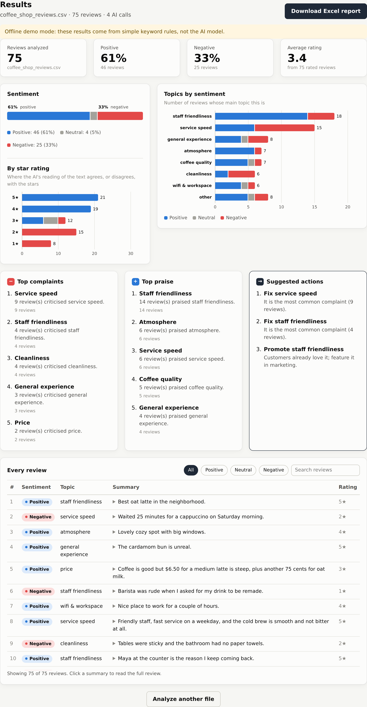
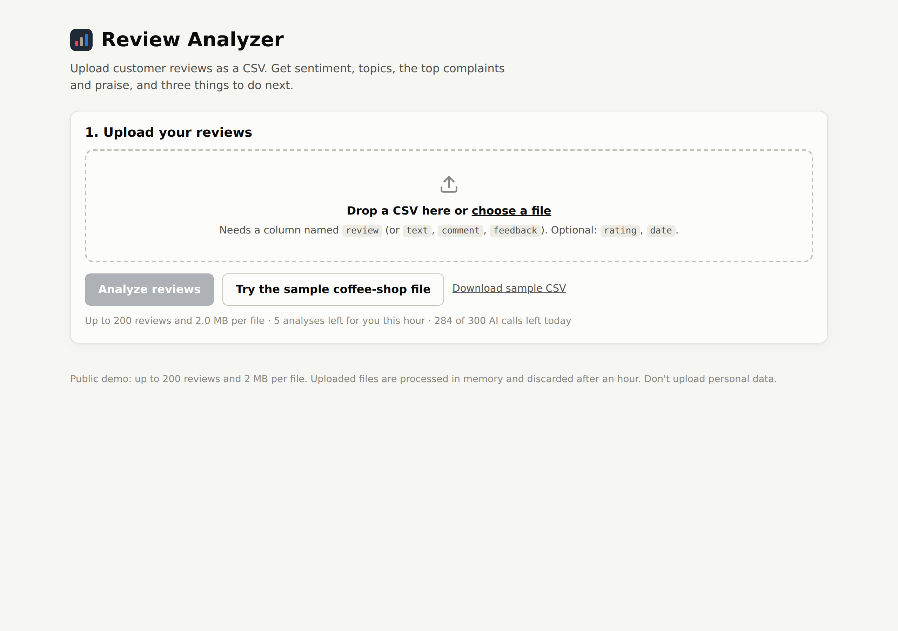
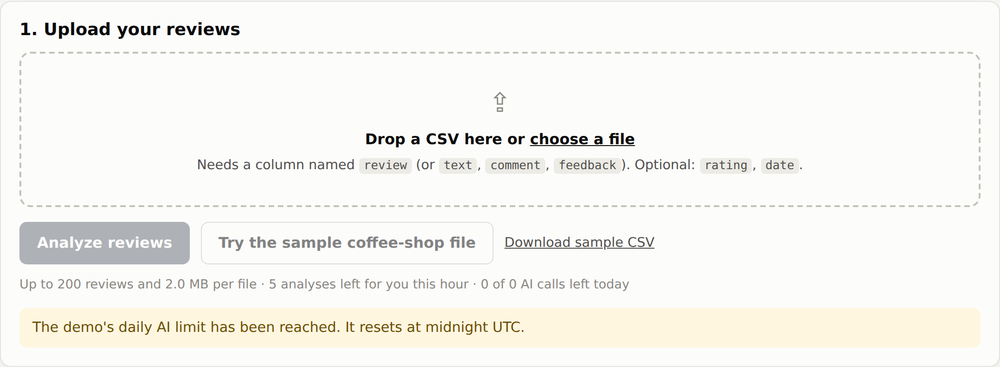
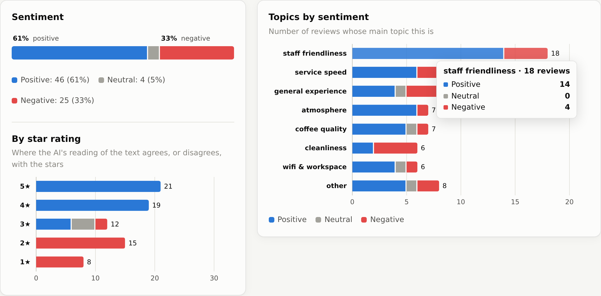
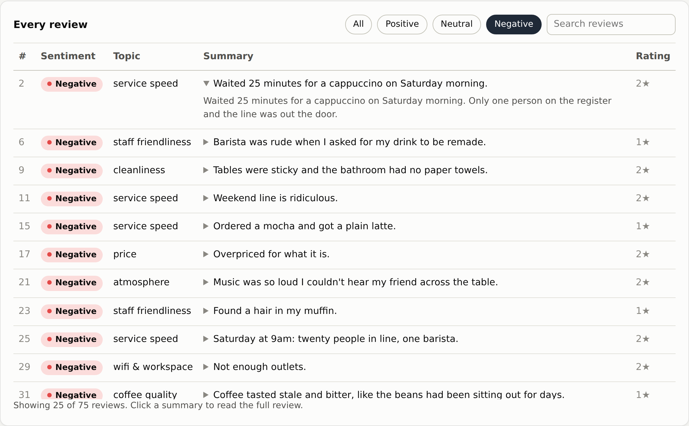
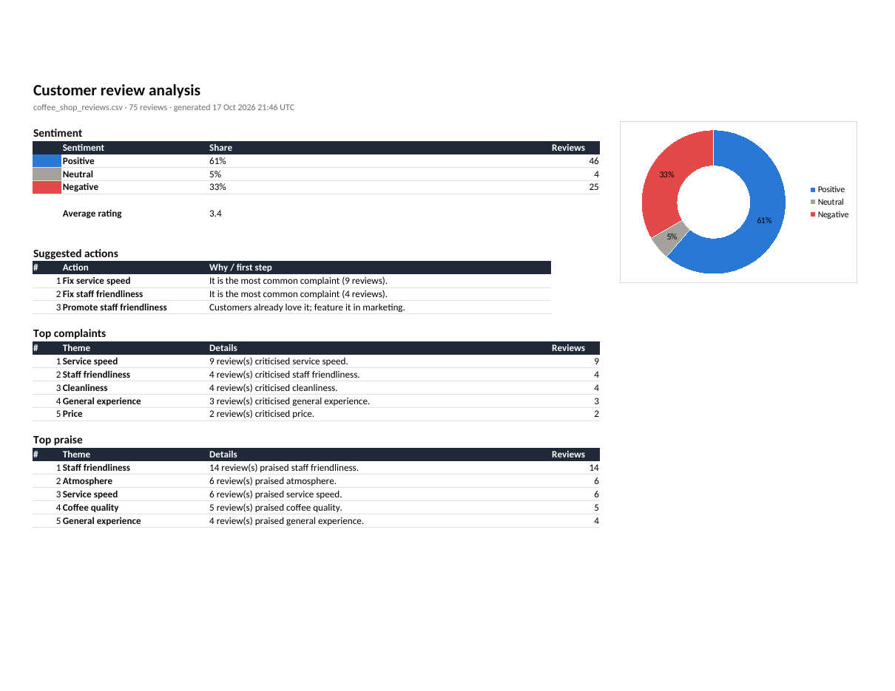
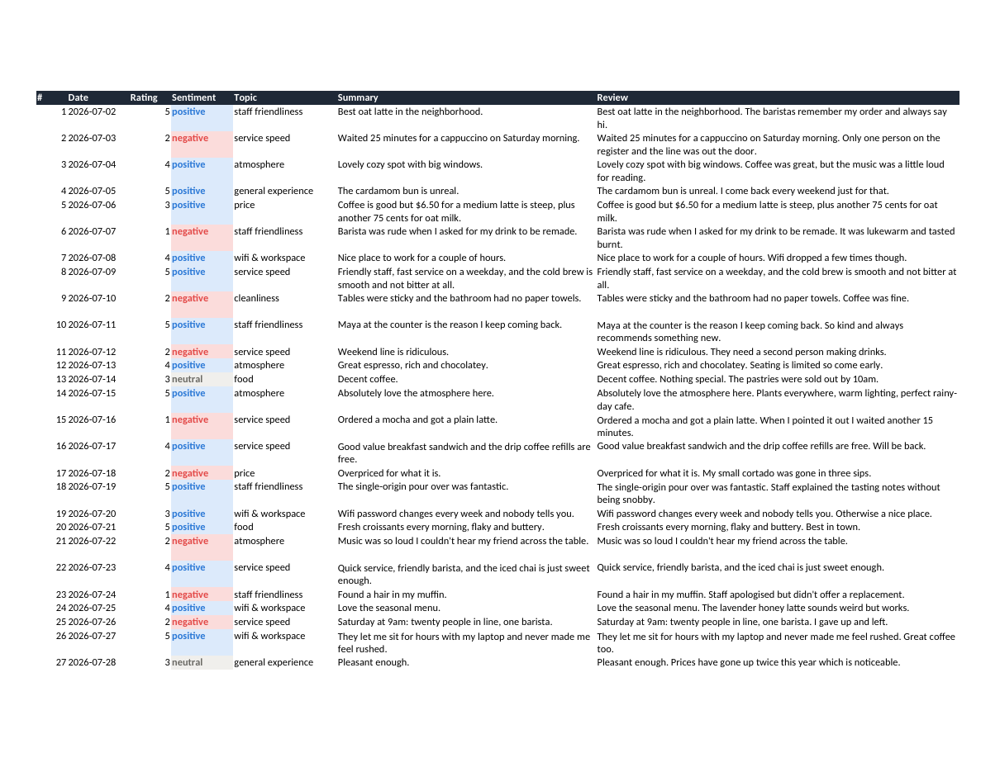
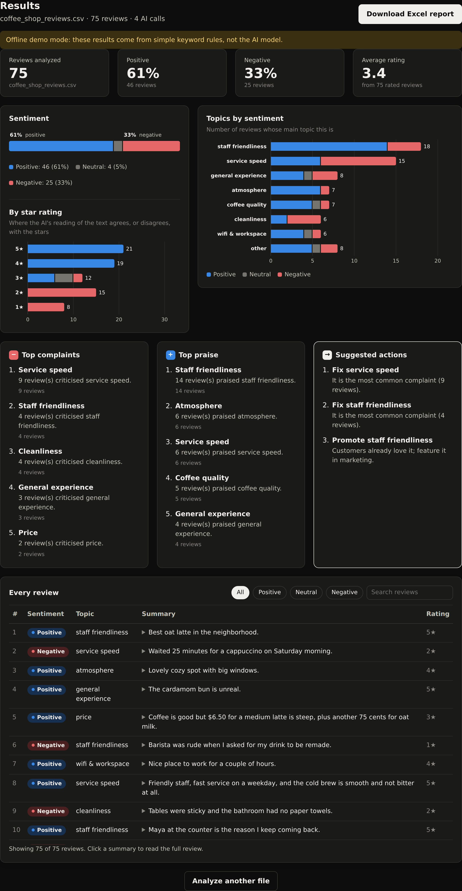

# Review Analyzer

Upload a CSV of customer reviews and get an AI analysis back in under a minute:

- **For each review:** sentiment, main topic, and a one-line summary
- **Overall:** the top complaints, the top praise, and **3 suggested actions** for the business
- **Charts and tables** on the page, plus a **formatted Excel report** to download

Built with FastAPI and Google Gemini, with a plain HTML/JS frontend (no frameworks, no CDNs).
The AI provider sits behind a small interface, so Claude or OpenAI can be swapped in by adding one file.

**Live demo:** https://review-analyzer.129-80-188-63.sslip.io. Click *Try the sample coffee-shop file*.



<details>
<summary>More screenshots</summary>

| | |
|---|---|
| **Upload**  | **Daily limit reached: the button disables itself**  |
| **Hover tooltips on charts**  | **Filterable review table**  |
| **Excel report: summary sheet**  | **Excel report: every review**  |
| **Dark mode**  | |

</details>

## How it works

```
Browser ──upload CSV──▶ FastAPI ──validate──▶ background job
                                              │
                    ┌─────────────────────────┴───────────────────────┐
                    │ 1. Split into batches of 25 reviews              │
                    │ 2. One AI call per batch (2 in parallel):        │
                    │      sentiment · topic · one-line summary        │
                    │ 3. One AI call over all results:                 │
                    │      complaints · praise · 3 actions · topic     │
                    │      grouping                                    │
                    │ Every call: JSON schema output, validated,       │
                    │ retried with backoff, charged to a daily budget  │
                    └─────────────────────────┬───────────────────────┘
Browser ◀──polls progress / gets results──────┘   ──▶ Excel report on demand
```

200 reviews take about 9 AI calls. Some design choices:

- **Structured output.** Every prompt comes with a JSON Schema. The response is checked again
  with pydantic, and a batch that comes back with a missing or malformed review is retried.
- **Grounded insights.** Each complaint and point of praise lists the review IDs behind it.
  IDs the model invents are dropped, so the "N reviews" counts are real.
- **Consistent topics.** Batches run in parallel and can name the same thing differently
  ("coffee taste" vs "coffee quality"). The summary call merges them into at most 8 topics.
- **Prompt-injection hygiene.** Review text is sent as JSON data after the instructions, and
  the system prompt tells the model to treat it as data.

## Cost and abuse protection

This runs as a public demo, so every limit is enforced on the server:

| Protection | Default | Where |
|---|---|---|
| Max file size | 2 MB (Caddy rejects bodies over 3 MB before they reach the app) | `csv_validation.py`, Caddy |
| Max reviews per file | 200 | `csv_validation.py` |
| Analyses per IP | 5 per hour (invalid uploads don't count) | `limits.RateLimiter` |
| **Hard daily cap on AI calls** | 300 per UTC day, stored in SQLite so restarts don't reset it. Retries count too. | `limits.DailyBudget` |
| Pre-flight budget check | A file is refused up front if the remaining budget can't cover it | `main.py` |
| Concurrent jobs | 3 | `main.py` |

When the budget runs out, `/api/status` reports it and the **Analyze button is disabled** with
an explanation. A job can never overshoot the cap: budget is reserved before every single HTTP call.

## CSV format

Only a review column is required. Its header can be `review`, `text`, `comment`, `feedback`,
`body`, or a few others. Optional `rating` (`4`, `4.5`, `4/5`, `★★★★`) and `date` columns are used
when present. UTF-8, UTF-8 with BOM (Excel's "CSV UTF-8"), and Windows-1252 all work, with
comma, semicolon, or tab delimiters.

Errors are written for the person uploading, not for a developer. For example:

> Couldn't find a review column. Name the column with the review text "review" (or "text",
> "comment", "feedback"). Columns found: "name", "email".

> This looks like an Excel (.xlsx) file. In Excel use File > Save As > 'CSV UTF-8', then upload that.

A sample file with 75 made-up reviews of a fictional coffee shop is in
[`sample_data/coffee_shop_reviews.csv`](sample_data/coffee_shop_reviews.csv).

## Run it locally

```bash
python3 -m venv .venv && source .venv/bin/activate
pip install -r requirements-dev.txt
cp .env.example .env          # then set GEMINI_API_KEY (free key: https://aistudio.google.com/apikey)
uvicorn app.main:app --reload
# open http://127.0.0.1:8000
```

No API key? Set `AI_PROVIDER=fake` to use an offline keyword-based stand-in. The page labels
its results as offline demo output.

All settings, including every limit above, are environment variables. See [`.env.example`](.env.example).

## Swapping the AI provider

`app/providers/base.py` defines the whole contract:

```python
class LLMProvider(Protocol):
    name: str
    async def generate_json(self, *, system: str, prompt: str, schema: JSONSchema) -> Any: ...
    async def aclose(self) -> None: ...
```

A provider makes one HTTP request per call and maps failures to `TransientProviderError`
(retry) or `PermanentProviderError` (stop). Batching, retries, validation and budget all
live in the analyzer, so a new vendor is about 80 lines: write `providers/claude.py` or
`providers/openai.py` and add a branch to `create_provider()`.

## Tests

```bash
pytest          # 59 tests, about 1 second, no network or API key needed
ruff check .    # lint
mypy app        # strict type checking
```

The tests cover CSV edge cases (encodings, delimiters, header variants, limits), the Gemini
client against a mocked HTTP transport (status codes, Retry-After, malformed JSON, blocked
prompts), the retry and budget logic (including "the cap holds even when every call fails"),
the full HTTP flow through to opening the generated Excel file, and the rate limits.

## Deployment

It runs on a small Ubuntu ARM server on Oracle Cloud:

```
Internet ─▶ Caddy :443 (automatic HTTPS, 3 MB body limit) ─▶ uvicorn 127.0.0.1:8010 (systemd)
```

```bash
bash deploy/install.sh   # venv, systemd service, Caddy, and iptables rules. Safe to re-run.
```

- `deploy/review-analyzer.service`: hardened systemd unit (read-only filesystem except
  `data/`, 512 MB memory cap, one worker because jobs are held in memory).
- `deploy/review-analyzer.caddy`: the site config. It uses an
  [sslip.io](https://sslip.io) hostname so HTTPS works without a domain. To use a real domain,
  change the hostname and point an A record at the server.
- Oracle Cloud blocks inbound ports twice: in the VCN **security list** (in the web console)
  and in the instance's own **iptables** rules. The install script handles iptables. In the
  security list, add ingress rules for TCP 80 and 443 from `0.0.0.0/0`.

## Project layout

```
app/
  main.py            FastAPI routes, upload handling, background jobs
  analyzer.py        batching, retries, validation, aggregation
  prompts.py         prompt text and JSON schemas
  providers/         base.py (interface), gemini.py, fake.py
  csv_validation.py  CSV parsing with friendly errors
  limits.py          per-IP rate limiter and persistent daily budget
  report.py          formatted Excel workbook (openpyxl, native Excel charts)
  jobs.py            in-memory job store
  models.py          pydantic data models
  config.py          settings from environment / .env
static/              index.html, styles.css, app.js (hand-drawn SVG charts)
sample_data/         demo CSV
tests/               pytest suite
deploy/              systemd unit, Caddy config, install script
scripts/             screenshots.py (regenerates the README images)
```
